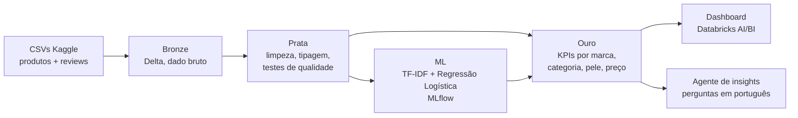

# Voz do Consumidor em Beleza

**O que faz um consumidor recomendar, ou não, um produto de skincare?**
Pipeline de dados no Databricks, modelo de NLP interpretável e dashboard sobre cerca de 1 milhão de reviews de produtos de beleza, comparando o portfólio do Grupo L'Oréal com o restante do mercado.

> **Resultado principal:** o modelo encontra **9 em cada 10 reviews de não recomendação** (recall 0,90, AUC 0,97). Quem recomenda fala de resultado visível (pele mais lisa, macia e luminosa). Quem não recomenda fala de **espinhas causadas pelo produto ("broke me out")**, produto que embola na pele, devolução e preço alto.


## Problema de negócio
Marcas de beleza recebem milhares de reviews por mês. Ler tudo é impossível. Este projeto transforma esse texto em indicadores e em uma lista de temas que mais afastam o consumidor, por categoria e tipo de pele, para orientar P&D, marketing e atendimento.

## Arquitetura



## Dados
[Sephora Products and Skincare Reviews](https://www.kaggle.com/datasets/nadyinky/sephora-products-and-skincare-reviews) (Kaggle): mais de 8 mil produtos e cerca de 1 milhão de reviews, retrato de março de 2023 do site Sephora US. As marcas do Grupo L'Oréal foram identificadas a partir de informações públicas (lista em `02_silver_limpeza.py`).

## Ferramentas
Databricks (Free Edition) · PySpark · Delta Lake · Unity Catalog · SQL · scikit-learn · MLflow · Databricks AI/BI Dashboards · LLM com tool calling (Foundation Model APIs)

## Agente de insights
Pergunte em português, por exemplo: _"Em quais categorias o Grupo L'Oréal fica abaixo das demais marcas para pele oleosa?"_. O agente descobre as tabelas, escreve e executa o SQL e responde citando a fonte.
- **Segurança:** só executa `SELECT`, só nas tabelas do projeto, com limite de linhas
- **Rastreabilidade:** cada passo fica registrado como trace no MLflow
- **Avaliação:** perguntas com resposta conhecida são comparadas com SQL feito à mão (acertos: _preencher_)

## Estrutura
```
notebooks/
  00_setup.py                    cria schema e volume
  01_bronze_ingestao.py          CSV → Delta
  02_silver_limpeza.py           limpeza, flag do grupo, testes de qualidade
  03_gold_metricas.py            tabelas de negócio
  04_ml_drivers_recomendacao.py  modelo + drivers, registrados no MLflow
  05_agente_insights.py          agente LLM que responde perguntas consultando as tabelas ouro
dashboard/README_dashboard.md    páginas e queries do dashboard
```

## Resultados
Base: 1.094.411 reviews e 8.494 produtos após ingestão; modelo treinado em amostra de 150 mil reviews (teste com 30 mil).

| Métrica | Valor |
|---|---|
| AUC | 0,969 |
| Recall "não recomenda" | 0,90 |
| Precision "não recomenda" | 0,70 |
| F1 "não recomenda" | 0,785 |
| Acurácia | 0,92 |

Só 16% das reviews de teste são de não recomendação, por isso o F1 e o recall dessa classe são as métricas principais, e não a acurácia.

**Principais insights**
- **Reação na pele é o motivo concreto mais forte de não recomendação.** Os termos "broke" e "caused" aparecem entre os 25 mais negativos, e a leitura das reviews confirma o padrão "broke me out" (o produto causou espinhas). Para uma marca, isso aponta para testes de comedogenicidade e comunicação clara de tipo de pele.
- **Textura na aplicação também afasta o consumidor.** "pills" (o produto embola na pele, inclusive sob a maquiagem) está entre os termos negativos.
- **Devolução e preço aparecem como consequência.** "returned", "returning" e "overpriced" indicam que a frustração vira perda de venda.
- **Quem recomenda descreve resultado visível:** "smoother", "soft", "glowing", "brighter", "helped". São esses benefícios que a comunicação deve destacar.

16 marcas do Grupo L'Oréal foram encontradas no dataset. Como as reviews cobrem só skincare, as marcas de cabelo e fragrância do grupo têm pouco peso na análise de texto.

## Limitações e próximos passos
- Reviews em inglês, de um único varejista, em 2023
- Avaliações online têm viés: quem escreve costuma estar muito satisfeito ou muito insatisfeito
- Os drivers mostram associação, não causa
- A remoção de palavras comuns quebrou alguns termos ("wanted to love" virou "wanted love", "don't" virou "don")
- Próximo: versão 2 do modelo sem palavras de sentimento genérico, para destacar só atributos do produto
- Próximo: publicar o agente como app (Databricks Apps ou Streamlit) para recrutadores testarem
- Próximo: modelo de tópicos (BERTopic) para agrupar reclamações por tema
